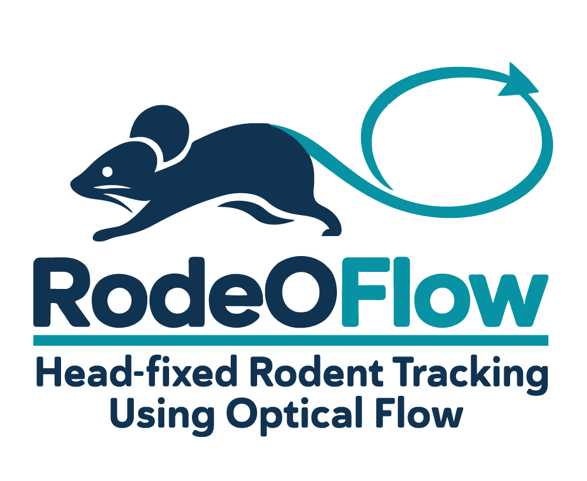

# RodeOFlow

<p align="center">
  <picture>
    <source media="(prefers-color-scheme: dark)" srcset="img/RodeOFlow_black.png">
    <source media="(prefers-color-scheme: light)" srcset="img/RodeOFlow_white.png">
    
  </picture>
</p>

RodeOFlow is a Python toolbox for quantifying facial and body movements in head-fixed mice. It combines pose estimation, dense optical flow, and kinematic analysis to extract synchronized movement features from video.


## Installation
The easiest way for installation is to use one of our simple installation scripts which you can download and run for an automatic installation process.
Since these scripts depend on conda, please make sure to have conda available on your system before running the scripts.

Download one of the following files depending on your OS:
* [Linux installer script](https://raw.githubusercontent.com/BarnstedtLab/RodeOFlow/dev/installer_linux.sh)
* [macOS installer script](https://raw.githubusercontent.com/BarnstedtLab/RodeOFlow/dev/installer_macos.sh)
* [Windows installer script](https://raw.githubusercontent.com/BarnstedtLab/RodeOFlow/dev/installer_windows.ps1)

After downloading, you just need to run one of the following commands (depending on your OS):

Linux:

```bash
bash /path/to/installer_linux.sh 
```

MacOs:

```bash
bash /path/to/installer_macos.sh 
```

Windows:

```powershell
.\path\to\installer_windows.ps1
```


**Alternatively**, you can setup the Conda environments yourself using our environment definition files by following our following instructions:

Download one of the following conda environment definition files depending on your OS:
* [Linux environment file](https://raw.githubusercontent.com/BarnstedtLab/RodeOFlow/dev/environment/environment_setup_linux.yaml)
* [macOS environment file](https://raw.githubusercontent.com/BarnstedtLab/RodeOFlow/dev/environment/environment_setup_macos.yaml)
* [Windows environment file](https://raw.githubusercontent.com/BarnstedtLab/RodeOFlow/dev/environment/environment_setup_windows.yaml)


Create and activate a Conda environment using the setup file for your operating system.

Linux:

```bash
conda env create -f environment_setup_linux.yaml
conda activate rodeoflow
```

Windows:

```bash
conda env create -f environment_setup_windows.yaml
conda activate rodeoflow
```


DeepLabCut uses its PyTorch backend in this toolbox. If it is not already installed in your environment, install it with:

```bash
python -m pip install --pre deeplabcut
```

Install RodeOFlow from GitHub:

```bash
python -m pip install git+https://github.com/BarnstedtLab/RodeOFlow.git --no-deps
```

The `--no-deps` option assumes that the required dependencies are installed through the Conda environment and the DeepLabCut step above. If you are installing into an environment without those dependencies, omit `--no-deps`.

## Workflow

RodeOFlow provides four main functions. Run pose estimation first, then analyze the resulting keypoint files.

| Workflow | Function | Purpose |
|---|---|---|
| Face | `pose_face()` | Detect facial keypoints used to define regions for optical-flow analysis. |
| Face | `analyse_face()` | Analyze facial movement and extract face features. |
| Body | `pose_body()` | Detect body keypoints. |
| Body | `analyse_body()` | Analyze body movement and extract gait features. |

### Face analysis

```python
from pathlib import Path
from rodeoflow import pose_face, analyse_face

video_dir = Path("/path/to/videos")
keypoint_dir = video_dir / "rodeoflow"

# Detect facial keypoints from videos in video_dir.
pose_face(video_dir)

# Analyze the generated facial keypoint files.
analyse_face(keypoint_dir)
```

### Body analysis

```python
from pathlib import Path
from rodeoflow import pose_body, analyse_body

video_dir = Path("/path/to/videos")
keypoint_dir = video_dir / "rodeoflow"

# Detect body keypoints from videos in video_dir.
pose_body(video_dir)

# Analyze the generated body keypoint files.
analyse_body(keypoint_dir)
```

When `video_dir` is a directory, the pose functions save keypoint outputs in its `rodeoflow` subdirectory. If you store the keypoint files elsewhere, pass that folder as `keypoint_dir`.

The pose functions provide options for selecting a tracking engine, model weights, video format, crop region, and whether to overwrite existing outputs. Face analysis also provides options for selecting the optical-flow engine, using NMF masks, and saving optical-flow vector fields. Body analysis accepts an optional `StrideConfig` for configuring stride-cycle analysis.

## Extracted features

### Face

Face analysis uses facial keypoints to define regions for dense optical-flow analysis. Extracted features include:

- Regional facial motion signals
- Pupil size and position
- Eye opening, blink events, and saccade-related pupil movement
- Nose and whisker-pad motion traces and frequency estimates
- Mouth movement features

### Body

Body analysis extracts framewise body-motion features and stride-cycle gait measurements, including:

- Paw, mouth, and tail movement
- Body-part angles
- Stride-cycle timing and measurements
- A processing summary with stride-detection and quality information

Analysis results are saved as HDF5 files with the suffix `_rodeoflow.h5`. Body analysis files contain a framewise `body` table, a `stride_cycles` table, and a `processing_summary` table.

## Dependencies

RodeOFlow uses [DeepLabCut](https://github.com/DeepLabCut/DeepLabCut), [Lightning Pose](https://github.com/paninski-lab/lightning-pose), [OpenCV](https://opencv.org/), and other Python packages listed in the environment setup files. Available tracking and optical-flow options depend on your setup.

## Contributors

RodeOFlow is under active development. We welcome feedback, ideas, and community contributions.

We thank our collaborators Tobias Ackels and Anantu Sunil (University of Bonn), Irina Dudanova (University of Würzburg), Sonja Blumenstock (UCSD), Janelle Pakan (LIN Magdeburg), Emilie Macé (UMG Göttingen), Simon Musall (RWTH Aachen), Jan Gründemann (DZNE Bonn), Yangfan Peng (Charité Berlin), Ricardo Paricio-Montesinos (DZNE Bonn), Sanja Mikulovic (LIN Magdeburg), Petra Mocellin (LIN Magdeburg), Liudmila Sosulina (LIN Magdeburg), and Falko Fuhrmann (DZNE Bonn) for generously sharing their data, which helped improve our pretrained models.

We are also grateful to Nick del Grosso and Sangeetha Nandakumar (iBOTS iBehave Bonn) for their support and Python expertise during the early development of the package.
